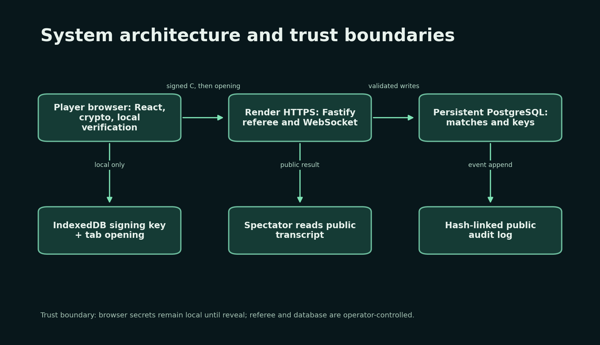

# RPS Commitments

A CS-3002 Information Security project that turns rock–paper–scissors into a verifiable commit–reveal tournament. Players choose moves locally, publish signed Pedersen P-256 or salted SHA-256 commitments, then reveal openings only after both commitments arrive. The referee runs two-player matches and 4/8-player brackets. A spectator can inspect public results and the hash-linked audit log.

**Live URL:** pending cloud account connection and end-to-end verification. The app is runnable locally now. See [deployment preparation](docs/deployment.md) and the [technical report](docs/report.pdf).

For a handover checklist with expected results and browser steps, follow [How to verify the project](docs/VERIFY.md).



## Quickstart

Use Node **20.20.2** and pnpm **12.18.0** (pinned in `package.json`). From the repository root:

```powershell
corepack enable
pnpm install --frozen-lockfile
Copy-Item .env.example apps/server/.env
pnpm dev
```

Open `http://127.0.0.1:5173`. Vite proxies API/WebSocket traffic to the Fastify server at `http://127.0.0.1:3000`; `/health` checks server readiness. The default SQLite database is stored under ignored `apps/server/data/`. For a persistent deployment, set `DATABASE_URL` to a private PostgreSQL connection string with TLS. Set `SERVE_WEB=1` after `pnpm build` to serve the client and API on one origin. Never commit `.env` or database credentials.

## Verify and reproduce results

```powershell
pnpm lint                 # ESLint
pnpm typecheck            # strict TypeScript
pnpm test                 # 27 crypto, attack, and API assertions
pnpm format:check         # Prettier
pnpm check:rng            # reject Math.random in crypto/server paths
pnpm build                # production React client
pnpm exec playwright install chromium
pnpm test:e2e             # two-browser game, 375px layout, Attack Lab
pnpm attacks              # A1–A10 raw JSON
pnpm bench                # 1,000 Node samples per operation
pnpm bench:browser        # 1,000 Chromium samples per operation
pnpm bench:timing         # comparison timing CSV
python scripts/plot_results.py
```

`pnpm play:match http://127.0.0.1:3000` is an additional two-client API smoke test. `pnpm seed:demo` creates a fallback four-seat tournament using `DEMO_USERNAME` and `DEMO_PASSWORD` from the environment; run it only on a test or classroom instance.

## Code and protocol

- `packages/crypto-core`: pinned hash-to-curve generator, P-256 Pedersen commitments, salted hash baseline, canonical encodings, transcript and audit verification.
- `packages/adversary-sim`: isolated `INSECURE-DEMO` attack examples. The production server never imports this package.
- `apps/server`: Fastify REST/WebSocket referee, Zod validation, session/key lifecycle, SQLite/PostgreSQL migrations, tournament advancement.
- `apps/web`: React player UI, guided tour, crypto inspector, Attack Lab, benchmarks, spectator and audit pages.
- `docs/`: [report source](docs/report.md), [PDF](docs/report.pdf), [slides](docs/slides.pdf), diagrams, threat model, raw benchmark/attack results, screenshots, and [progress gates](docs/PROGRESS.md).

Before reveal, a commit request contains only a commitment, mode, key ID, and signature. A browser-held opening supplies the move and random value later. Signatures bind tournament, match, round, player, mode, and commitment. The browser recomputes pinned public parameters and verifies both openings and signatures. Sessions are HTTP-only, expire after an hour, and are stored server-side as hashes.

## Limits, team, and license

A malicious server could leak the first received opening before the second reveal or rewrite the entire audit chain without an external checkpoint. A lost browser tab may lose an opening and forfeit. Local and browser benchmarks are machine-specific; cloud latency is not yet measured. See the [threat model](docs/threat-model.md) and [attack notes](docs/attacks.md).

The course requires exactly three members. [Team details](docs/TEAM.md), individual contributions, and the third roll number await confirmation; Git commits are attributed only to the account that made them. The team has not selected a reuse license, so no open-source license is granted yet.
