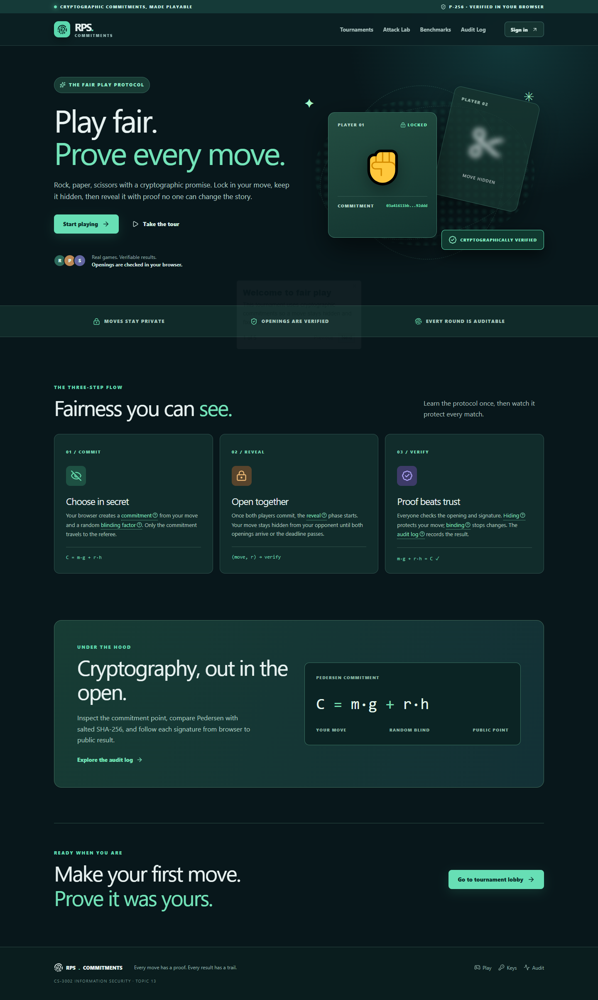
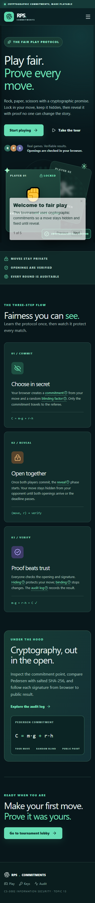
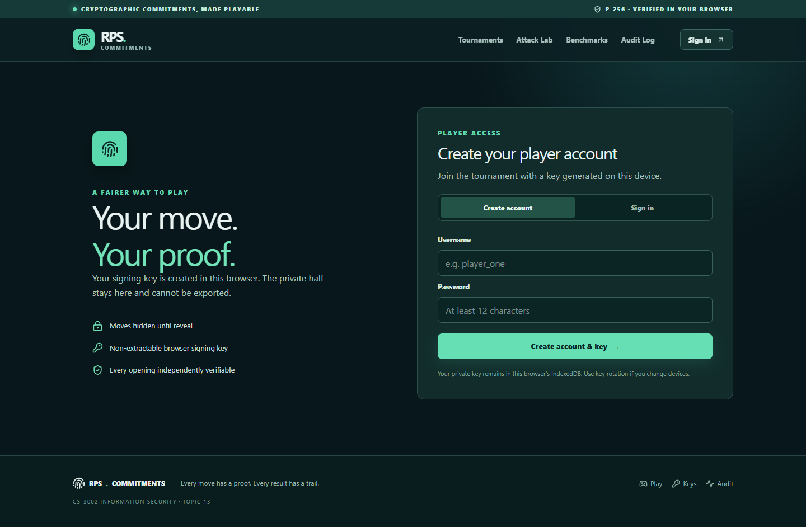
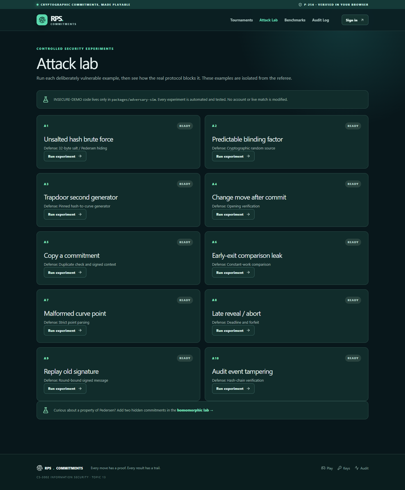
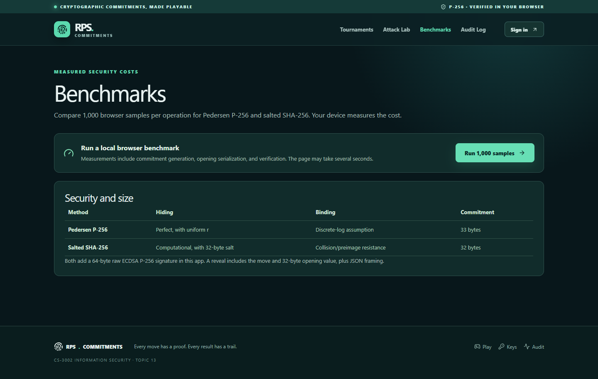
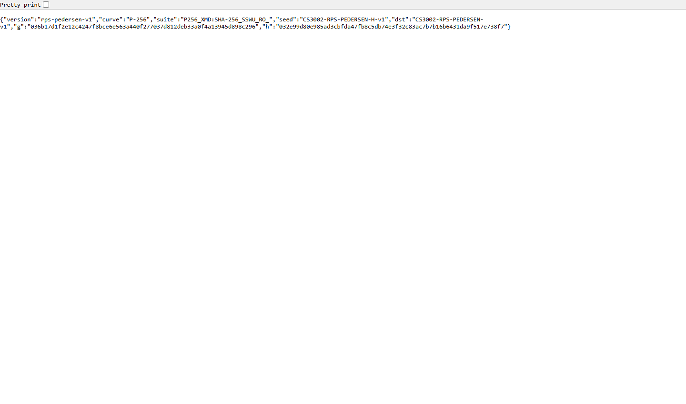

# RPS Commitments — final project review

**Review date:** 25 November 2026  
**Website:** https://rps-commitments.vercel.app/  
**Code:** https://github.com/Zubair378/rps-commitments  
**Course:** CS-3002 Information Security, Topic 13

## Submission decision

**Do not submit as fully complete yet.** The website's public pages work, but the WebSocket fix is on branch `fix/render-websocket` (commit `6ab14a4`), while production `main` is still `9b6c486`. The live Vercel WebSocket failed; the direct Render WebSocket opened. More importantly, the course requires exactly three team members with genuine contributions and a four-player tournament on different devices. The repository's `docs/TEAM.md` still has placeholders, and Git history on `main` shows only Zubair Tariq as an author. The team must confirm the missing facts; no names or contributions should be invented.

## How the project works

1. A player signs in and creates a P-256 signing key inside the browser. Only the public key goes to the server.
2. The player chooses rock, paper, or scissors. The browser creates a random blinding value and a Pedersen commitment `C = m·g + r·h`. It signs the commitment with the player's key.
3. The server receives the commitment and signature. It does not receive the move or blinding value at this stage.
4. Once both players have committed, each browser sends its move and blinding value. The server checks the opening and determines the round result.
5. Browsers independently check the published openings and signatures. A tournament advances winners through semifinals and a final.
6. The Attack Lab contrasts weak examples with protected behavior; benchmarks measure costs; the public audit page verifies a linked event log. The server still controls deadlines and could rewrite an unanchored log, as the report explains.

The React frontend is hosted on Vercel. Its REST API requests are routed to the Fastify service on Render. The production database is described as PostgreSQL/Neon in the deployment plan; **its actual configuration and persistence after restart were not independently inspected in this review**.

## Evidence from this review

| Check                                                                      | Result                              | What it establishes                                                                                                                                                     |
| -------------------------------------------------------------------------- | ----------------------------------- | ----------------------------------------------------------------------------------------------------------------------------------------------------------------------- |
| GitHub Actions for fix commit `6ab14a4`                                    | Passed                              | The branch's configured CI checks completed successfully. It is not merged into production.                                                                             |
| Desktop and mobile homepage, sign-in, Attack Lab, benchmarks               | Loaded in Edge                      | The browser rendered these public pages on 25 November.                                                                                                                 |
| Public `/api/params`                                                       | HTTP 200 in Edge                    | The browser reached the cryptographic parameters endpoint. Command-line requests got a Cloudflare HTTP 429 challenge, so automated CLI health checks were inconclusive. |
| Public audit page                                                          | Hash chain verified in browser      | Current public events passed the client verifier at the time of testing. This does not prevent a server from rewriting the entire chain.                                |
| WebSocket at Vercel host                                                   | Failed to open                      | The production frontend route still does not provide the match WebSocket.                                                                                               |
| WebSocket at Render host                                                   | Opened                              | The backend WebSocket endpoint was reachable from the same browser.                                                                                                     |
| Two-player browser match, key rotation/revocation, four-player API bracket | Passed in earlier 17 November tests | Useful prior evidence; these were not repeated on the new URL today.                                                                                                    |
| Four physical devices and database after restart                           | Not tested                          | Needs the team and Render dashboard.                                                                                                                                    |

## Screenshots from 25 November

## Checks for the team on two PCs

Use the two computers in separate browser profiles. For a required four-player test, each PC must open **two isolated profiles** (not four tabs sharing one login), or use four devices. Create four new accounts. Create a four-seat tournament, join all four, and complete both best-of-three semifinals and the final. Record a screenshot of the bracket showing the champion and each client's verified openings. Check the commit request in browser Network tools: it must contain a commitment and signature but no `move` or `blindingFactor`. Test one key rotation and revocation; check the audit page. If a rate-limit message appears, record the time, browser action, HTTP status, and response headers. The earlier four-profile test hit a rate limit during a semifinal after heavy test traffic; the cause has not been resolved.

For persistence, record the tournament ID and participant count, deliberately restart the Render service in the correct account, and reload the same tournament URL. If it still exists with the same data, record the before/after screenshots and restart time. A successful health response alone does not prove Neon persistence.

## Required work before submission

1. Merge the tested WebSocket branch through the team's PR process and verify the live Vercel build opens the direct Render socket. The branch CI is green; the live site is still on the older main commit in this review.
2. Complete the four-player browser test on the two PCs, investigate any rate-limit failure, and confirm database persistence after restart.
3. Confirm all three members' names, roll numbers, GitHub identities, and real code contributions. Update `docs/TEAM.md`, the technical report and slides with truthful attribution.
4. Update **only your own row** of the Topic Selection Sheet with the GitHub and live site URLs. The course overview says no GCR upload is required.
5. Rehearse the live demo three times, prepare a fallback recording, and write two or three questions for the group presenting after yours once its topic is known.
6. Rebuild `docs/report.pdf` after the team details and final deployment evidence are added. The current report PDF exists, but its team section is incomplete. The presentation PDF also exists; review it with all three presenters.

## Suggestions that may improve marks

Prioritize reliable demonstration and evidence over new features. A screenshot of the complete four-player bracket, verified openings, key revocation, audit result, and persistence after restart directly supports the marking requirements. Add a small table of measured live load/response times to the report. Explain the honest limits: the first opening is visible to the server when received, the server sets deadlines, and the audit chain has no external checkpoint. Optional internationalization or offline export are lower priority than these requirements.

**Scope of this review:** public browser behavior, repository contents, GitHub CI and existing course documents. It is not a formal security audit. Test accounts and unfinished tournaments created by earlier checks may still be in the production database.
