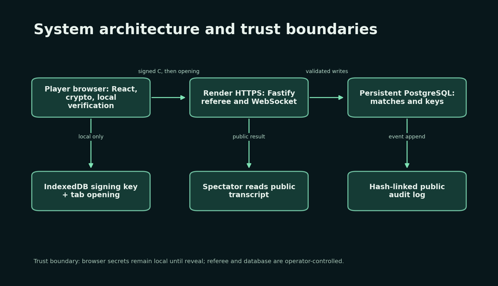
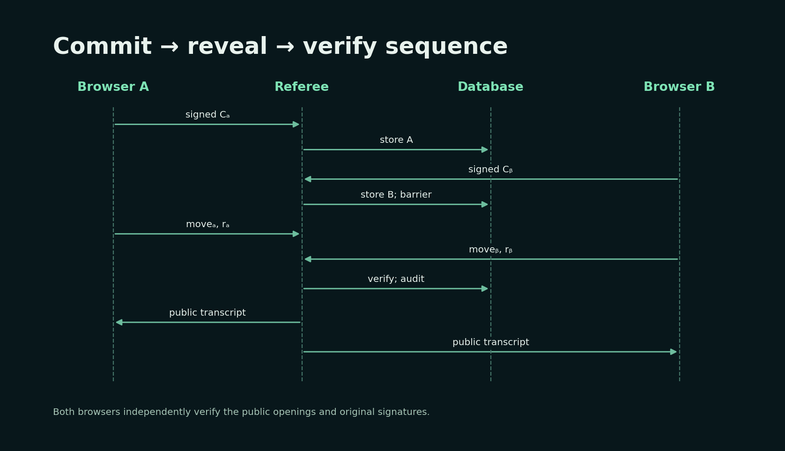
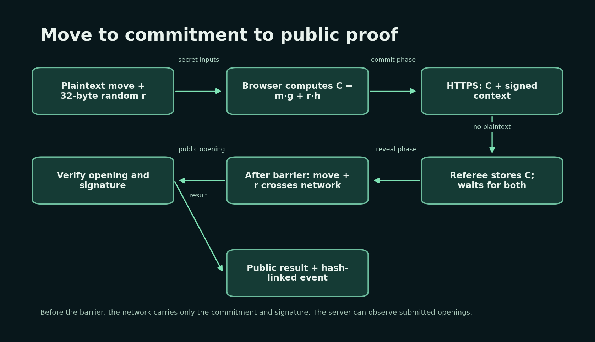
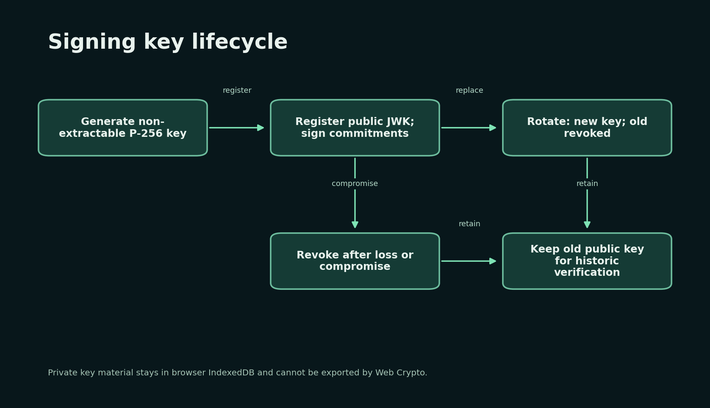
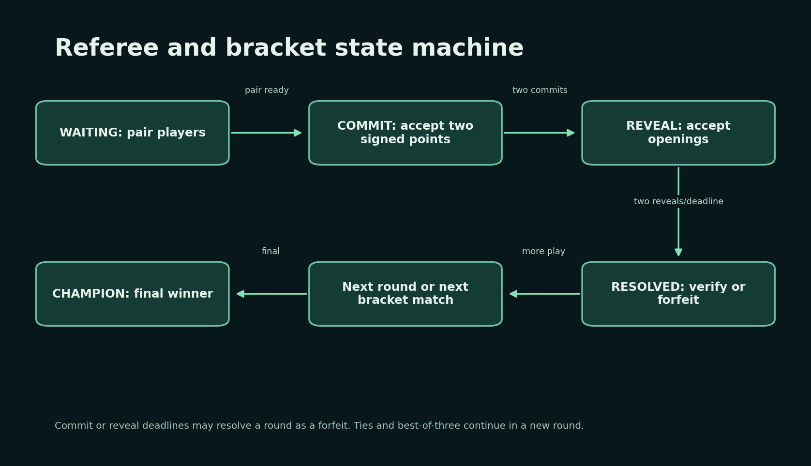
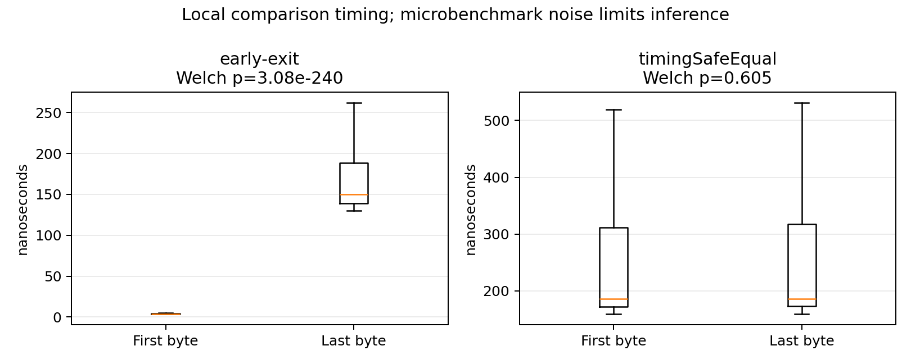
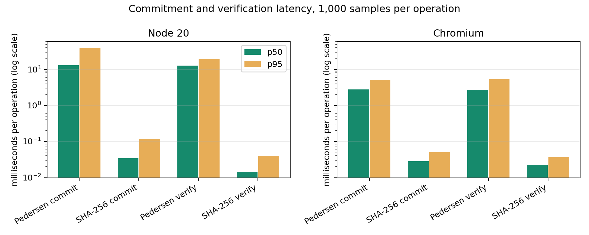

# Cryptographic Commitments for Fair Rock–Paper–Scissors

**CS-3002 Information Security · Topic 13 · Technical report**  
**Repository:** https://github.com/Zubair378/rps-commitments  
**Team:** exactly three members; names and roll numbers to be confirmed in `TEAM.md`  
**Live URL:** pending account connection and cloud verification

## Abstract and problem statement

In an ordinary online rock–paper–scissors game, the second player to reveal can choose a winning move. This project implements a browser tournament in which players first publish cryptographic commitments, then reveal moves and random opening values. The referee accepts both commitments before entering the reveal phase. Each opening and the original context-bound signature is independently checked in the browser. A 4- or 8-player single-elimination bracket and best-of-three matches make the protocol usable in a classroom demonstration. The project compares Pedersen commitments on P-256 with a salted SHA-256 baseline, tests ten attacks against deliberately weak examples and real defenses, and records reproducible latency data. It also states the remaining trust in the server and deployment platform.

## 1. Background

A commitment has two main properties. **Hiding** prevents an observer from learning the chosen message before opening. **Binding** prevents the committer from opening one commitment to a different message. Pedersen's construction is `C = m·g + r·h` in the P-256 group, where `m ∈ {1,2,3}` represents rock, paper, or scissors and `r` is a uniformly sampled scalar. If `r` is uniform across the full scalar field, the distribution of `C` is independent of `m`: hiding is perfect. Binding is computational when nobody knows the discrete logarithm between the independent generators `g` and `h`. A salted hash commitment encodes domain, player, match, round, move, and 32-byte salt into SHA-256. Its hiding depends on the salt remaining unpredictable, and its binding depends on hash resistance.

The protocol uses the established P-256 group implementation and Web Crypto signatures. It does not implement curve arithmetic, SHA-256, or ECDSA itself. `h` is derived by RFC 9380 hash-to-curve from a fixed project seed and domain separation tag, then pinned to a compressed point. The browser recomputes and checks those parameters before making a commitment. The full scalar field includes zero; excluding it would make the hiding claim only approximate. Identity commitments are resampled or rejected.

## 2. Threat model

An opponent may guess a move, copy a point, replay a signature, submit malformed data, withhold a reveal, or try to open to a different move. A network observer sees HTTPS traffic but should not see plaintext moves before reveal. The server controls state and deadlines; a malicious operator can see a received opening before the second opening and can rewrite its own database. Browser storage and the device are trusted for local secrets. A compromised browser extension or device can read the move and initiate actions on the player's behalf. The full [attack-surface map](threat-model.md) covers REST, WebSocket, cookies, database, local storage, parameter exchange, dependencies, and hosting configuration.

## 3. System architecture and data flow

The React client generates keys, computes commitments, signs context, stores openings, and re-verifies public transcripts. Fastify manages sessions, tournament brackets, deadlines, signed commitments, reveals, results, WebSocket notifications, and the audit chain. SQLite is used locally; production requires persistent PostgreSQL. A same-origin Render deployment is prepared so HTTP-only session cookies do not depend on third-party cookie behavior. A spectator can read a match and public evidence without possessing either player's private key.

Before the reveal barrier, the `POST /api/commit` body contains the compressed point or hash, mode, key ID, and ECDSA signature. The move and opening value are in the player's tab session storage. After both commitments are accepted, `POST /api/reveal` sends the move and opening value. The server verifies and eventually publishes both openings. A Playwright test inspected the actual commit request and asserted that it contained neither `move` nor `blindingFactor`.

## 4. Cryptographic design and encodings

P-256 points are encoded canonically as 33-byte compressed hex. Scalars and salts are exactly 32 bytes of lowercase hex; scalars at or above the curve order are rejected. Moves are integers 1, 2, and 3. A rejection sampler draws 32 random bytes from `crypto.getRandomValues` until they are below the group order, avoiding modulo bias. SHA-256 commitment inputs use length-prefixed fields and a round number in four-byte big-endian format, with a project domain string to prevent cross-protocol reuse. ECDSA P-256 with SHA-256 signs a canonical message containing tournament ID, match ID, round number, player ID, commitment mode, and commitment. The server verifies the signature against the registered public JWK and rejects revoked keys. Constant-time comparison is used for fixed-length secret/token checks on the server.

For a valid reveal, the browser recomputes `m·g + r·h` or the salted digest and verifies the signature using the stored public key. It does not treat a server-reported `valid` flag as sufficient evidence. A public key remains readable after revocation so a historical signature can still be checked. The audit chain hashes previous hash, sequence number, event type, event JSON, and timestamp, beginning from 64 zero hex characters.

## 5. Library choices and maintenance

`@noble/curves` 2.4.0 and `@noble/hashes` 2.4.0 provide the group, hash-to-curve, SHA-256, canonical point decoding, and byte helpers. Web Crypto supplies non-extractable ECDSA keys and cryptographic randomness in the browser. Fastify 5, Zod 4, Kysely, PostgreSQL/SQLite drivers, React 19, Vite 8, Vitest 3, and Playwright 1.65 provide the application and test layers. Versions are pinned or recorded in `pnpm-lock.yaml`; CI installs with `--frozen-lockfile`. Dependencies must still be reviewed and updated as security advisories appear. No audit of these third-party libraries was performed by the team.

## 6. Key lifecycle

At registration, the browser creates a non-extractable P-256 ECDSA private key in IndexedDB and uploads only the public JWK. Rotation creates a new key, registers it, and revokes the old key in one database transaction. Revocation prevents new commitments while preserving historical verification. A login on a new device generates a new local key. A lost private key cannot be recovered, and a lost tab opening can cause a round forfeit; the UI warns when it cannot find an opening for a committed round.

## 7. Implementation, API, and state machine

`packages/crypto-core` contains the protocol and audit verifier. `apps/server` contains the Fastify referee, database migrations, and tests. `apps/web` contains the player, spectator, keys, audit, attack, and benchmark pages. `packages/adversary-sim` contains only `INSECURE-DEMO` examples and is not imported by production server code. `scripts/` contains smoke, attack, benchmark, plotting, and seed tools.

Important routes are `GET /api/params`, `POST /api/register|login|logout`, `POST /api/keys/register|rotate|revoke`, `GET /api/keys/:id`, `POST/GET /api/tournaments`, `POST /api/tournaments/:id/join`, `GET /api/matches/:id`, `POST /api/commit`, `POST /api/reveal`, `GET /api/audit`, and `GET /ws/matches/:id`. Inputs are schema validated. Sessions use random tokens stored only as SHA-256 hashes, expire after one hour, and are revoked on logout.

The referee pairs players, accepts at most one distinct signed commitment per player and match round, opens reveal only after both commitments, resolves on two openings or deadline, and advances a winner. Ties create another round. Four- and eight-player tournaments use best-of-three matches; a two-player tournament uses one round. A forfeiture can resolve a match early. A hurdle was preserving the exact perfect-hiding statement: the staged guide suggested excluding zero from the scalar sample range, which would slightly bias the distribution. The implementation includes zero and documents this choice. Another hurdle was browser key persistence: a lost HTTP response after a successful commit must not destroy the opening, so the UI stores it before sending the request.

## 8. Security evaluation

Ten controlled demonstrations each assert that a deliberately vulnerable example is exploitable and the corresponding protected path blocks the attempt. `pnpm attacks` writes [raw results](results/attacks.json); `pnpm test` checks both outcomes. The [attack notes](attacks.md) contain individual explanations and caveats.

| Attack                       | Weak result                              | Protected result                               |
| ---------------------------- | ---------------------------------------- | ---------------------------------------------- |
| A1 Unsalted three-move hash  | Recovered move in 3 guesses              | Unknown 256-bit salt defeats those guesses     |
| A2 Predictable random factor | Recovered move from known PRNG seed      | Cryptographic random factor defeats prediction |
| A3 Known `log_g h`           | Forged second opening                    | Pinned hash-to-curve generator rejects it      |
| A4 Changed move              | Naive referee accepts                    | Opening verification rejects                   |
| A5 Copied commitment         | Naive referee accepts                    | Duplicate and identity checks reject           |
| A6 Early-exit comparison     | Prefix-dependent work and timing         | Constant-work comparison / `timingSafeEqual`   |
| A7 Invalid point             | Length-only parser accepts               | Canonical point parser rejects                 |
| A8 Late reveal               | No-deadline referee accepts              | Deadline rule rejects and can forfeit          |
| A9 Signature replay          | `C`-only signature verifies in new round | Context-bound signature fails                  |
| A10 Edited audit event       | Plain log displays edit                  | Browser detects broken chain                   |

The timing study measured 2,000 batches per condition. An early-exit comparator averaged 6.1 ns for a first-byte mismatch and 194.7 ns for a last-byte mismatch (Welch p ≈ 3.1×10⁻²⁴⁰). Node `timingSafeEqual` averaged 256.6 ns and 261.8 ns (p ≈ 0.605). The local result does not prove a whole network path constant-time or demonstrate a remote exploit. Hash-chain verification detects partial edits; a server operator who rewrites the entire chain can avoid detection until external anchoring exists.

## 9. Security versus usability

[Node and browser benchmarks](benchmarks.md) record 1,000 samples per operation and mode. Node median Pedersen commit and verify were 13.1205 ms and 12.6732 ms; salted SHA-256 was 0.0337 ms and 0.0143 ms. Chromium medians were 2.8000 ms and 2.7000 ms for Pedersen, versus 0.0280 ms and 0.0220 ms for salted SHA-256. These are one machine's measurements and are not comparable across environments. Pedersen's 33-byte point is only one byte larger than SHA-256's 32-byte digest. Both send a 64-byte raw ECDSA signature and later a move plus 32-byte opening value, before JSON overhead. Pedersen gives perfect hiding under uniform `r`, while salted hashing is far faster but requires an unpredictable salt. Signing keys and deadlines add user steps; the guided tour, progress states, and key page explain them.

In a local two-browser test, one click-to-committed path took 775 ms and the second reveal-to-both-verified path took 1,458 ms. These include local network, server, UI polling, and cryptographic work, so they are not pure crypto measurements. Cloud latency and cold starts have not been measured.

## 10. Testing and CI

Vitest covers nine crypto properties and vectors, ten attack scenarios, and eight backend tournament/API cases (27 tests total). Playwright covers two independent browser profiles completing a match, a 375px layout check, and the Attack Lab; a separate browser benchmark test records raw samples. CI runs lint, TypeScript checking, unit/API tests, formatting, an insecure-RNG scan, production build, and Chromium E2E on each PR. Tests reject malformed points and scalars, wrong openings, unsigned/copy/replay/revoked commitments, and missed deadlines. Screenshots are committed under `docs/results/ui/`.

## 11. Deployment

`render.yaml` prepares one free Render service using Node 20.20.2, a production build of the React client, Fastify static serving on the same origin, a PostgreSQL `DATABASE_URL`, and `/health`. A local production-style smoke test returned 200 for `/health`, `/`, a deep client route, and `/api/params`. [Deployment instructions](deployment.md) explain how to connect a persistent Neon database and verify the public URL. The cloud accounts are not connected to this coding session yet, so there is no verified live URL or cloud cold-start measurement. Render's free web service can spin down after inactivity; its local filesystem is ephemeral and unsuitable for the database.

## 12. Limitations and future work

The server sees an opening when the first player submits it and could leak it before the second reveal. A malicious server can manipulate deadlines or rewrite the entire audit chain; an external timestamped checkpoint or multi-party witness would improve accountability. Cryptographic proofs do not prevent a compromised browser or stolen session from acting as the player. The local E2E test covers a complete two-player match and the API test covers a four-player bracket; a public four-device tournament must be tested after deployment. Future work includes external audit anchoring, device-to-device key recovery, offline transcript export, and independent security review.

## 13. Team contributions

The course requires exactly three members, each with code commits and a defense-ready understanding of all parts. `TEAM.md` contains three slots; names, roll numbers, GitHub usernames, and individual contributions are awaiting confirmation. Git history currently attributes repository commits to the account that performed them. No work is attributed to another member without evidence.

## 14. References

1. RFC 9380, _Hashing to Elliptic Curves_: https://www.rfc-editor.org/rfc/rfc9380
2. NIST FIPS 186-5, _Digital Signature Standard_: https://csrc.nist.gov/pubs/fips/186-5/final
3. NIST FIPS 180-4, _Secure Hash Standard_: https://csrc.nist.gov/pubs/fips/180-4/upd1/final
4. `@noble/curves` project documentation: https://github.com/paulmillr/noble-curves
5. Web Crypto API specification: https://www.w3.org/TR/WebCryptoAPI/
6. Render Blueprint specification: https://render.com/docs/blueprint-spec
7. Render free service limitations: https://render.com/docs/free
8. Vercel external rewrites: https://vercel.com/docs/routing/rewrites
